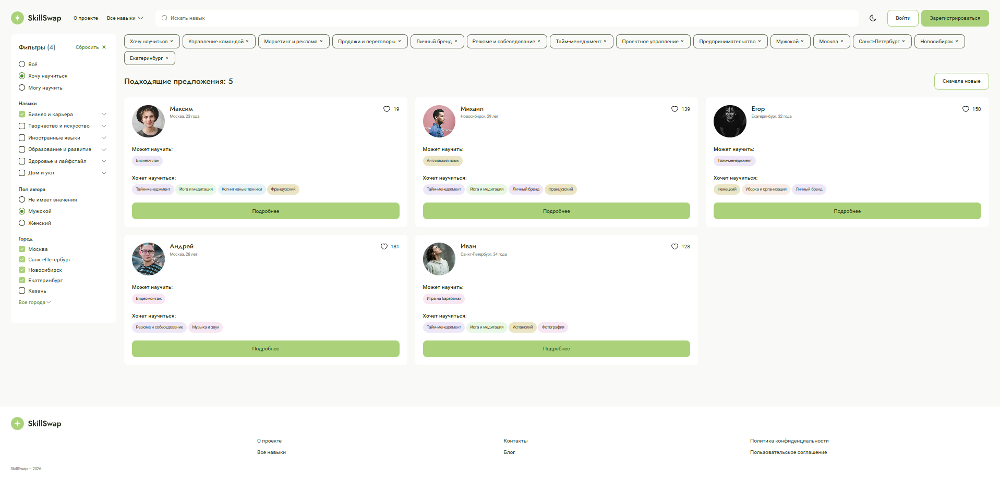

# SkillSwap 🔄

Платформа обмена навыками: пользователи предлагают то, чему могут научить, и ищут тех, кто научит их тому, что хотят освоить. Дипломный командный проект на React + TypeScript с архитектурой Feature-Sliced Design.

## 🚀 Демо

- **GitHub Pages:** [https://alexandrookunev.github.io/SkillSwap_57_1/](https://alexandrookunev.github.io/SkillSwap_57_1/)
  *(✅ Работает в РФ без VPN)*

## 🛠 Стек

- **Core:** React 18, TypeScript
- **State:** Redux Toolkit, типизированные хуки `useAppDispatch` / `useAppSelector`
- **Routing:** React Router v6 (HashRouter для статического хостинга, lazy-загрузка страниц)
- **Формы/валидация:** React Hook Form + Yup
- **Сборка:** Vite, vite-plugin-svgr (SVG как React-компоненты)
- **Тесты:** Vitest + React Testing Library
- **Качество:** ESLint, Stylelint, Prettier
- **CI/CD:** GitHub Actions, GitHub Pages

## 🧩 Архитектура

Проект построен по методологии **Feature-Sliced Design**: слои `app / widgets / features / entities / shared` с чётким разделением ответственности и зависимостями только «сверху вниз». Это позволяет изолировать бизнес-логику, переиспользовать UI-кит и масштабировать кодовую базу.

- `src/api/` — функции загрузки данных из статического JSON-слоя (`public/db/*.json`).
- `src/store/` — конфигурация Redux store и типизированные хуки.
- `src/entities/` — доменные модели (Skill, User, Request) и их слайсы.
- `src/features/` — фичи: auth, favorites, notifications, swap-request.
- `src/widgets/` — составные блоки: Header, SkillCard, FiltersSidebar, RegisterStep*.
- `src/shared/` — атомарный UI-кит (Input, Popover, Autocomplete, Select, Tag, Avatar и др.), хуки, типы, константы.

## ✨ Функционал

- Каталог навыков с секциями «Популярное / Новое / Рекомендуем».
- Многокритериальная фильтрация: режим, навыки (с indeterminate-состояниями), пол автора, город; счётчик активных фильтров и сброс.
- Поиск с автодополнением (Autocomplete на базе Popover, ARIA-атрибуты).
- Детальная страница навыка, избранное, заявки на обмен с персистентностью в `localStorage`.
- Многошаговая регистрация с каскадной валидацией и загрузкой изображений.
- Авторизация через JWT-подобный токен, защищённые маршруты (`PrivateRoute`).
- Уведомления, тёмная тема, адаптивная вёрстка.

## 👥 Командный проект и моя роль

Диплом выполнен командой (когорты 57, Яндекс Практикум). Исходный репозиторий команды: [PM-YandexPracticum/SkillSwap_57_1](https://github.com/PM-YandexPracticum/SkillSwap_57_1). В этом форке — моя зона ответственности и настройка деплоя.

Мой вклад (по PR-ам):
- **UI-кит:** универсальный `Input` (варианты, состояния, валидация на CSS-переменных), управляемый `Popover`, `Autocomplete` с фильтрацией подсказок и ARIA.
- **Фильтрация:** виджет `FiltersSidebar` с indeterminate-чекбоксами, счётчиком и сбросом.
- **Регистрация:** 3-й шаг — форма добавления навыка с каскадной валидацией и загрузкой изображений; модалка `RegistrationSuccessModal`.
- **Заявки на обмен:** Redux-срез с сохранением в `localStorage`, кнопка с проверкой авторизации, модалка успеха, покрытие unit-тестами.
- **Графика:** импорт SVG через `vite-plugin-svgr`, адаптация ~40 иконок/иллюстраций под `currentColor`.
- **Деплой:** настройка GitHub Actions для автодеплоя на GitHub Pages, относительные пути к данным и ассетам через `import.meta.env.BASE_URL`.

## 📦 Данные

Справочные данные лежат в `public/db/` и отдаются статически (без внешнего бэкенда): `skills.json`, `users.json`, `categories.json`, `cities.json`, `notifications.json`. Структура объектов описана в `src/shared/types/index.ts`.

### Тестовый аккаунт для входа
- Email: `ivan@mail.ru`
- Пароль: `Baraban2024`

## ⚙️ Запуск локально

**Требования:** Node.js 18+

1. Установка:

        git clone https://github.com/AlexandroOkunev/SkillSwap_57_1.git
        cd SkillSwap_57_1
        npm install

2. Режим разработки:

        npm run dev

    Приложение будет доступно по адресу: `http://localhost:5173`

3. Продакшен-сборка:

        npm run build

## 🧪 Тесты и качество

| Скрипт | Что делает |
|--------|------------|
| `npm run dev` | Запуск dev-сервера |
| `npm run build` | Сборка для продакшена |
| `npm run lint` | Проверка ESLint + Stylelint |
| `npm run lint:fix` | Автоисправление lint-ошибок |
| `npm run format` | Форматирование через Prettier |
| `npm run test` | Запуск unit-тестов (Vitest) |
| `npm run test:watch` | Тесты в watch-режиме |
| `npm run test:coverage` | Покрытие тестами |

## 🔀 Роутинг

Маршруты объявлены в `src/shared/lib/constants.ts` → `ROUTES`. Lazy-загрузка страниц настроена в `src/app/providers/RouterProvider.tsx`. Защищённые маршруты оборачиваются в `PrivateRoute` из `src/features/auth/ui/` — неавторизованный пользователь перенаправляется на `/login`.

Для корректной работы на статическом хостинге используется `HashRouter`.

## 🔐 Переменные окружения

Создай `.env.local` для локальных настроек (исключён из git):

    VITE_APP_TITLE=SkillSwap

Доступ в коде: `import.meta.env.VITE_APP_TITLE`

## 🔄 CI/CD

GitHub Actions (`ci.yml`) на каждый push/PR прогоняет:

    npm run lint
    tsc --noEmit
    npm run test
    npm run build

GitHub Actions (`deploy-pages.yml`) собирает проект через Vite и публикует на GitHub Pages при пуше в `develop`. Пайплайн использует `environment: github-pages` и `concurrency` для стабильного деплоя без конфликта артефактов.
